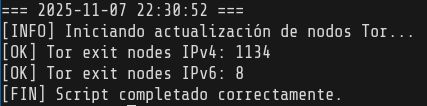

# Bloquear Tor (Tor Exit Nodes Blocker)

## Español

Script que mantiene actualizadas las listas de nodos de salida de Tor (IPv4 e IPv6) y bloquea su tráfico con `ipset` + `iptables`. Pensado para **administradores de sistemas** que quieran reducir tráfico automatizado o abusivo proveniente de la red Tor.

**Advertencia:** este script **no busca afectar la privacidad de los usuarios de Tor en general**, sino proteger servidores concretos. Úsalo con responsabilidad.

### Características

- Bloqueo de nodos de salida Tor **IPv4 e IPv6** (las IPv6 se obtienen de [Onionoo](https://metrics.torproject.org/onionoo.html), ya que `exit-addresses` solo publica IPv4).
- Bloqueo de entrada en `INPUT`, `DOCKER-USER` (contenedores Docker) y `ts-input` (Tailscale); las cadenas que no existan se saltan solas.
- Bloqueo opcional de conexiones salientes hacia nodos Tor.
- **Nunca deja el servidor sin protección**:
  - descarga y valida antes de tocar nada; la lista se sustituye de forma atómica (`ipset swap`);
  - si la descarga falla o llega cortada, usa la última lista buena guardada en disco (también al arrancar sin red);
  - si `iptables` no responde o el set queda vacío, termina con error en vez de dar un falso OK.
- Las reglas se revisan en cada ejecución: si Docker o Tailscale las borran o las mueven, se vuelven a poner arriba, sin duplicados.
- Log con límite de frecuencia de las conexiones bloqueadas (`[TOR BLOCKED ...]` en el log del kernel).
- Una sola ejecución a la vez (`flock`), log en `/var/log/bloquear_tor.log` y en el journal.
- Aviso por correo opcional con `msmtp` (por defecto solo si hay avisos o errores).
- Modos `status` y `remove`.

### Requisitos

- Linux con `iptables` (legacy o nft), `ipset`, `curl` y `flock`.
- `jq` para la lista IPv6 (sin él solo se bloquea IPv4).
- Root.

```bash
sudo apt install ipset curl jq
```

### Instalación

```bash
sudo install -m 700 bloquear_tor.sh /usr/local/bin/bloquear_tor
# Opcional: configuración propia
sudo install -m 600 bloquear_tor.conf.example /etc/default/bloquear_tor
# Opcional: rotación del log
sudo install -m 644 logrotate.bloquear_tor /etc/logrotate.d/bloquear_tor
```

Programarlo con **systemd** (recomendado: se ejecuta al arrancar y cada 6 h):

```bash
sudo install -m 644 systemd/bloquear_tor.service systemd/bloquear_tor.timer /etc/systemd/system/
sudo systemctl daemon-reload
sudo systemctl enable --now bloquear_tor.timer
```

O con **cron** (`sudo crontab -e`):

```
0 */6 * * * /usr/local/bin/bloquear_tor
@reboot sleep 90 && /usr/local/bin/bloquear_tor
```

### Uso

```bash
sudo bloquear_tor            # actualizar (por defecto)
sudo bloquear_tor status     # ver cuántas IPs hay y qué reglas están puestas
sudo bloquear_tor remove     # quitar reglas y sets
```

Ver los bloqueos en el log del kernel: `sudo journalctl -k | grep "TOR BLOCKED"`.



## English

Script that keeps Tor exit node lists (IPv4 and IPv6) up to date and blocks their traffic using `ipset` + `iptables`. Intended for **system administrators** who want to reduce automated or abusive traffic coming from the Tor network.

**Warning:** this script does **not** aim to affect Tor users' privacy in general, only to protect specific servers. Use responsibly.

### Features

- Blocks Tor exit nodes over **IPv4 and IPv6** (IPv6 addresses come from [Onionoo](https://metrics.torproject.org/onionoo.html), since `exit-addresses` only lists IPv4).
- Inbound blocking on `INPUT`, `DOCKER-USER` (Docker containers) and `ts-input` (Tailscale); missing chains are skipped.
- Optional blocking of outgoing connections to Tor exits.
- **Never leaves the server unprotected**:
  - downloads and validates before touching anything; lists are replaced atomically (`ipset swap`);
  - if the download fails or is truncated, the last good list saved on disk is used (also at boot without network);
  - if `iptables` is not working or the set ends up empty, it exits with an error instead of a false OK.
- Rules are checked on every run: if Docker or Tailscale remove or move them, they are put back on top, without duplicates.
- Rate-limited logging of blocked connections (`[TOR BLOCKED ...]` in the kernel log).
- Single instance (`flock`), logs to `/var/log/bloquear_tor.log` and the journal.
- Optional email notifications via `msmtp` (by default only on warnings or errors).
- `status` and `remove` modes.

### Requirements

- Linux with `iptables` (legacy or nft), `ipset`, `curl` and `flock`.
- `jq` for the IPv6 list (without it only IPv4 is blocked).
- Root.

### Installation

```bash
sudo install -m 700 bloquear_tor.sh /usr/local/bin/bloquear_tor
sudo install -m 600 bloquear_tor.conf.example /etc/default/bloquear_tor   # optional
sudo install -m 644 logrotate.bloquear_tor /etc/logrotate.d/bloquear_tor  # optional
sudo install -m 644 systemd/bloquear_tor.service systemd/bloquear_tor.timer /etc/systemd/system/
sudo systemctl daemon-reload
sudo systemctl enable --now bloquear_tor.timer
```

Or use cron: `0 */6 * * * /usr/local/bin/bloquear_tor` plus `@reboot sleep 90 && /usr/local/bin/bloquear_tor`.

### Usage

```bash
sudo bloquear_tor            # update (default)
sudo bloquear_tor status     # show set sizes and active rules
sudo bloquear_tor remove     # remove rules and sets
```


